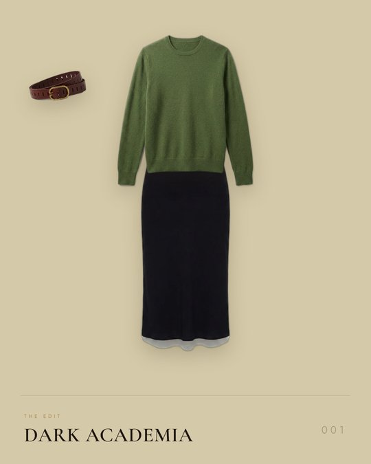
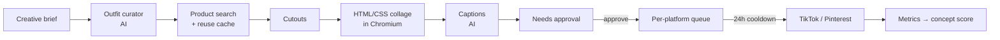
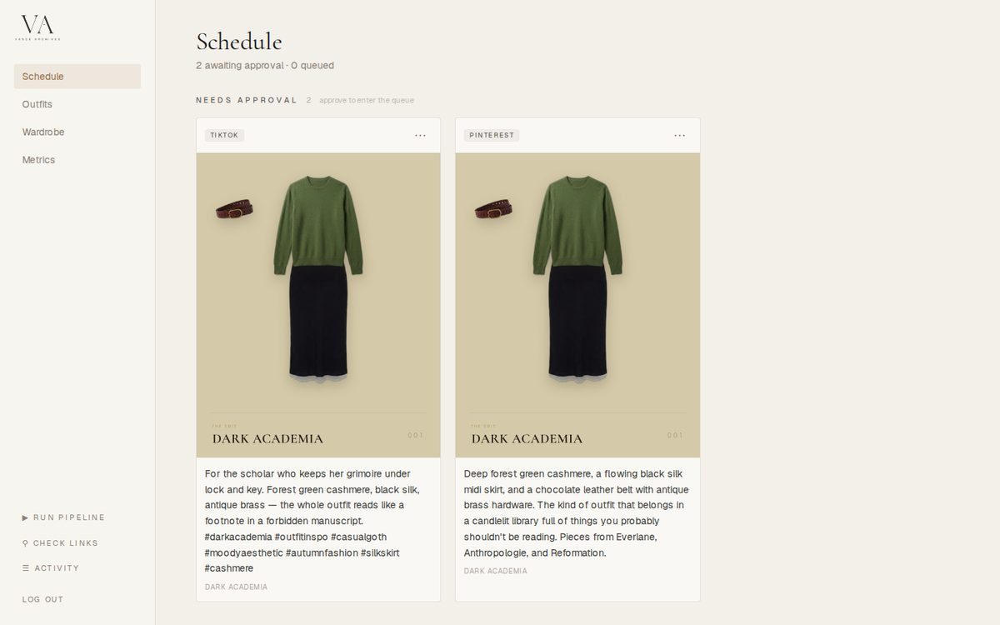
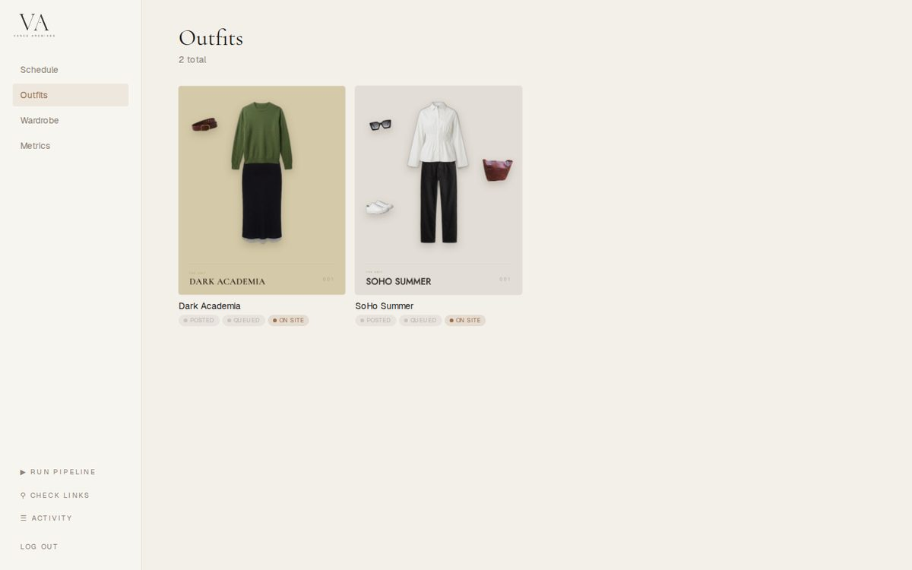
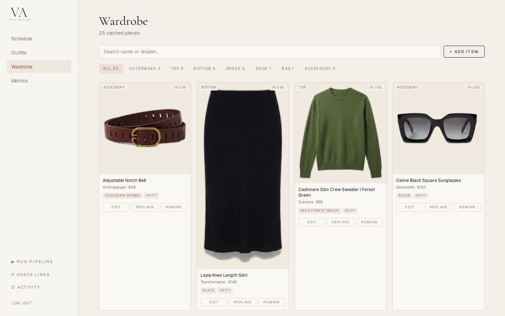

# Vance Archives

An AI-assisted fashion content engine. It turns a creative brief — *"Dark
academia"*, *"Bad Bunny summer concert"* — into five styled outfits built from real,
shoppable products, renders each one as an editorial collage, writes the captions,
and publishes through an approval queue to TikTok and Pinterest. A public site shows
every look with its products; an admin dashboard runs the whole thing.

<p>
  
  
</p>

**Stack:** Python · Next.js 16 / TypeScript · Supabase (Postgres + Storage) · Vercel ·
Railway (Docker) · Anthropic API · Playwright/Chromium · GitHub Actions

## Status

**Archived (November 2026).** The paid services — LLM, product search, and the
worker host — are switched off, so the pipeline isn't running. Everything is intact,
tested, and documented; it can be brought back with keys alone (see
[Reconnecting](#reconnecting)).

## How it works



The rule throughout: **AI only for subjective decisions** — interpreting the
brief, judging whether products work together, writing copy. Concept rotation,
product reuse and ranking, image processing, layout, queueing, and scoring are
ordinary deterministic code with tests.

A few things worth a look:

- **A curator agent that checks its own work.** It generates outfit specs, then
  reviews the products search actually returned, rejects mismatches, and
  re-searches only those slots with refined queries.
- **Template-first collages.** Each outfit's layout template is chosen *before*
  generation, so products are sourced to fit the layout. Collages are HTML/CSS
  screenshotted in headless Chromium — the fifth renderer design.
- **A web app that can't run the pipeline.** Vercel can't run Python, so the
  dashboard writes to a `jobs` table and a Dockerized worker on Railway claims
  and runs the work.
- **A publishing queue with no clocks.** Approved posts drain one per platform per
  24h. The cooldown is derived from post history and counts failures, so a broken
  token can't burn through the queue. It replaced a time-slot scheduler that
  broke at daylight saving time.
- **A security audit that found a critical bug** — row-level security was off and
  the public key could run arbitrary SQL — fixed and documented in
  [docs/security.md](docs/security.md).

The full story, with tradeoffs, is in the **[build log](docs/progress.md)**.

## Dashboard



| | |
|---|---|
|  |  |

## Repository layout

```text
app/
  agents/        outfit curator, engagement, style, and prompt agents
  collage/       HTML/CSS template renderer (+ legacy PIL renderer)
  db/            data access, Postgres schema + RLS hardening
  pipelines/     daily, image, collage, publish, analytics pipelines
  services/      product search, image isolation, storage, TikTok, Pinterest, LLM
scripts/         worker, OAuth helpers, seeding, maintenance
tests/           pytest suite (hermetic)
web/             Next.js public site + admin dashboard (Vitest suite in web/tests)
docs/            architecture, build log, design docs
```

## Running locally

Tests need no keys or network — the Python suite runs on SQLite and the dashboard
suite mocks Supabase.

```bash
python3 -m venv .venv && source .venv/bin/activate
pip install -r requirements.txt pytest
pytest -q

cd web && npm ci && npm test
```

To run the site and dashboard against a database, copy `web/.env.example` to
`web/.env.local`, fill in Supabase values, and run `npm run dev`
(http://localhost:3100; set `ADMIN_DEV_BYPASS=true` to skip the admin login).

## Reconnecting

Everything is configuration. Copy `.env.example` → `.env` and
`web/.env.example` → `web/.env.local`; each variable is documented in place.

1. **Database.** Create a Supabase project and run `app/db/schema_postgres.sql` in
   the SQL editor. It creates the tables, the SQL bridge functions the Python data
   layer uses, and — last — the RLS hardening block (keep it). Seed the concept
   pool with `python scripts/generate_seed_sql.py` and run its output the same
   way. Storage buckets are created automatically on first upload.
2. **LLM.** Set `ANTHROPIC_API_KEY`.
3. **Products.** Set `PRODUCT_SEARCH_PROVIDER` (`apify`, `serpapi`, or `awin`) and
   its key. `fixtures` works offline with sample products.
4. **Worker.** Deploy the root `Dockerfile` (Railway or any container host) with the
   `.env` values. It runs `scripts/worker.py --loop`: dashboard jobs plus the
   publish-queue tick.
5. **Site.** Deploy `web/` to Vercel with the `web/.env.example` variables.
6. **Publishing (optional).** Run `scripts/tiktok_auth.py` and
   `scripts/pinterest_auth.py` for tokens, set `PUBLIC_ASSET_BASE_URL` to the site's
   domain, then `AUTOPOSTING_ENABLED=true` and `DRY_RUN=false`. Platform
   constraints (private-only TikTok posting, Pinterest sandbox) are in
   [docs/autoposting.md](docs/autoposting.md).

## Documentation

| Doc | |
|---|---|
| [Build log](docs/progress.md) | How it was built, phase by phase, with tradeoffs |
| [Architecture](docs/architecture.md) | Topology, stage interfaces, caching, deployment |
| [Pipeline](docs/pipeline.md) | Every stage, in order |
| [Autoposting](docs/autoposting.md) | Approval queue, cooldown, TikTok/Pinterest setup |
| [Product sourcing](docs/product_sourcing.md) | Providers, reuse, retailer policy, affiliate links |
| [Security](docs/security.md) | The audit: RLS, dependency CVEs, secret scanning |
| [Website](docs/website.md) | Public site, admin dashboard, data contracts |
| [Creative briefs](docs/creative_briefs.md) · [Concept scoring](docs/concept_scoring.md) · [Terminology](docs/terminology.md) | The content model |
| [Agent prompts](docs/agent_prompts.md) · [LLM agents](docs/ai_agents.md) · [Image service](docs/image_service.md) · [Stage contracts](docs/api.md) | Component detail |
| [Roadmap](docs/roadmap.md) | What would come next if revived |

## License

[MIT](LICENSE).
