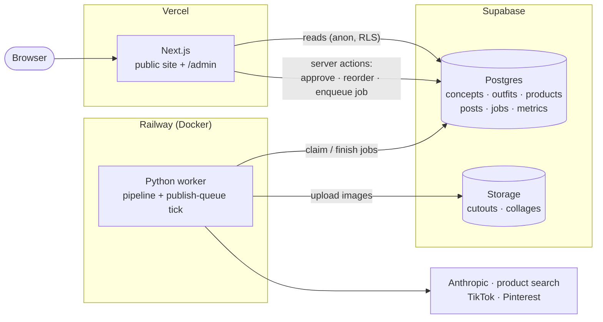

# System Architecture

## Philosophy

Use AI for creativity. Use software engineering for everything else.

The system treats concepts as structured creative briefs. A brief can include a seed idea, context, cultural references, inspiration images or known looks, color cues, occasion, budget, required details, and avoid rules. Deterministic modules must preserve that context instead of flattening it into a generic outfit category.

Initial AI behavior is API-backed. Agent modules call the configured LLM provider, request structured JSON, and pass responses through deterministic validators before the pipeline continues.

Concept selection is score based. The system begins with 8 active creative brief concepts, each starting at score `50`. A run selects the top-ranked eligible concept, generates 5 outfits from it, and drafts 1 TikTok slideshow post and 5 Pinterest posts. Concepts used within the previous 2 days are ineligible. Concepts below score `25` are retired and replaced.

Nothing publishes on generation. Drafts wait for human approval in the dashboard, then join a per-platform FIFO queue that the worker drains at most once per cooldown window (default 24h) — see [Publisher](#publisher).

## Runtime Topology



Vercel can't run the Python pipeline, so the dashboard never calls it directly. It writes a row to the `jobs` table; the long-running worker claims jobs, runs pipeline stages, and writes results back. The same worker loop runs the publish-queue tick. The public site reads Supabase directly with the anon key (read-only by RLS); the dashboard and worker use the service-role key server-side.

Every module should have:

- One responsibility
- One input
- One output
- One test suite
- One interface

---

## Pipeline

```text
Scheduler
  -> Outfit Agent
  -> Product Pipeline
  -> Collage Agent
  -> Engagement Agent
  -> Publisher
  -> Analytics
  -> Prompt Agent
```

---

## Stage Interfaces

### Outfit Agent

Input:

- creative brief
- outfit history

Output:

- structured outfit concept
- selected products
- search strategy

The Outfit Agent is responsible for interpreting nuance. For example, a brief like "Bad Bunny summer concert outfit" should not simply become "linen summer outfit." It may produce product search intent around Puerto Rican color references, statement accessories, streetwear silhouettes, warm-weather comfort, or specific public styling references when available and appropriate.

---

### Product Pipeline

Input:

- outfit search strategy

Output:

- selected product records
- stored product candidates
- normal product URLs
- nullable affiliate URLs
- downloaded images
- metadata

Product search sits behind a `ProductSearchProvider` interface, selected by `PRODUCT_SEARCH_PROVIDER`: Tavily (first, retired), SerpAPI Google Shopping, Apify (the last live provider), the AWIN affiliate catalog, or built-in `fixtures` for offline runs and tests. Provider-specific result fields are normalized before storage so the source can change without touching outfit generation, collage rendering, or the website. See [product_sourcing.md](product_sourcing.md).

Product records store `url` and `affiliate_url` separately. `url` is the standard product page used by the website today. `affiliate_url` remains null until a configured affiliate resolver can produce a tracked link.

Search results are reused before any paid call is made — see [Caching](#caching) for the three-layer strategy (explicit LLM reuse, the deterministic near-match gate, and the planned Redis provider cache).

---

### Collage Agent

Input:

- products
- images

Output:

- finished collage
- stored layout manifest with canvas and per-piece coordinates

The collage layer is deterministic rather than AI-backed. Collages are HTML/CSS pages laid out by declarative per-shape templates (`app/collage/html_export.py`) and screenshotted with headless Chromium. The template is chosen up front by the outfit curator, so the items are sourced to fit the layout they'll be rendered in. Each piece's position, size, and product ID is stored in the database so the website can recreate the collage without reverse-engineering the final PNG. The earlier PIL geometry renderer (`app/collage/export.py`) remains as a fallback and for its category→zone classifier.

---

### Engagement Agent

Input:

- creative brief
- outfit

Output:

- captions
- hashtags
- music category

---

### Publisher

Input:

- collage
- caption
- links

Output:

- local publish record
- optional platform identifiers when manually supplied

The publishing layer always creates post records first, as drafts that need approval. Approving a draft appends it to its platform's FIFO queue. When `AUTOPOSTING_ENABLED=true`, the worker's `process_queue_tick` publishes the head of each platform's queue once that platform's cooldown (`POST_COOLDOWN_HOURS`, default 24) has elapsed. The cooldown is derived, not stored — the latest of any post's `published_at` or failed-attempt stamp — so a broken token can't burn through the whole queue. "Post now" bypasses the cooldown. See [autoposting.md](autoposting.md).

TikTok photo posts and Pinterest pins require publicly reachable image URLs, so `PUBLIC_ASSET_BASE_URL` must point at a host serving the collage images (in production, Supabase Storage proxied through the site's own domain).

---

### Analytics

Input:

- post ids

Output:

- metrics
- post score adjustment
- updated concept ranking score

---

### Prompt Agent

Input:

- engagement history

Output:

- replacement creative brief

---

## Data Flow

```text
Creative Brief
  -> Outfit Concept
  -> Products
  -> Images
  -> Collage
  -> Caption
  -> Publish
  -> Metrics
  -> Optimization
```

---

## Caching

Product search has three reuse layers, cheapest first. All are deterministic —
no AI, consistent with the philosophy above.

1. **Explicit LLM reuse.** The Outfit Agent may name a `use_cached_url` from
   inventory it already knows; `resolve_cached_product` returns that product with
   no search.
2. **Deterministic near-match gate** (`find_cached_match`). Before paying to
   search, reuse an already-sourced product with the same garment zone + colour
   family + overlapping garment-type tokens. Operates on the `products` table,
   which is the persistent, source-of-truth product store — effectively a
   semantic product cache that survives restarts.
3. **Redis provider cache** *(planned)*. Layers 1–2 reuse *products*; a brand-new
   query still pays the API even if a similar one ran yesterday. This layer caches
   the *search round-trip itself* for an identical query, so repeat runs (e.g. a
   concept re-run inside its 2-day ineligibility window) skip the network.

Redis-layer design rules:

- **Decorator at the `ProductSearchProvider` Protocol boundary.**
  `CachedProductSearchProvider` implements the same interface, so
  `resolve_products_from_searches` and the Outfit Agent are unchanged (one
  interface, one responsibility).
- **Cache the post-filter/rank output, not raw provider JSON.** A
  `ProductSearchResult` is already the normalized, source-agnostic shape, so it
  serializes cleanly and the cache never learns provider internals. Tradeoff: a
  change to ranking/blocklist logic only reaches cached queries after TTL expiry;
  acceptable because those rules change rarely, and the `v1:` key prefix forces a
  global refresh when needed.
- **Fetch-wide, slice-narrow.** Call the underlying provider with a fixed max
  limit, cache that, and slice to the caller's `limit` on return, so different
  `limit` values share one entry.
- **Only paid external providers are wrapped**, gated by an `is_paid_external`
  flag (Apify / SerpApi / Tavily). AWIN is a local SQLite FTS5 query
  (`search_catalog`) — effectively free — so it is never cached; Redis buys
  nothing there.
- **Graceful degradation.** Redis is an optimization, never a dependency. Every
  Redis call is wrapped; on any connection or serialization error the decorator
  falls through to the live provider and logs. The pipeline runs identically with
  Redis absent.
- **TTL, not event invalidation.** Products go out of stock and reprice, but there
  is no stock-change feed to invalidate on. TTL (default 24h,
  `PRODUCT_SEARCH_CACHE_TTL_SECONDS`) is the pragmatic bound; it aligns with the
  daily run and the 2-day concept-ineligibility window. Availability correctness
  stays with the downstream `link_health` check and the `products` store — this is
  explicitly a **cost/latency cache, not a correctness cache.** Errors are not
  cached (so a transient failure isn't frozen); empty results are cached only on a
  short TTL (so a temporarily-empty query can recover).

**Interaction with the AWIN migration.** The Redis layer matters most *while a
paid API is the primary source*. Once AWIN becomes primary, most searches hit the
free local catalog and the cache is dormant by design (unwrapped) — still
available for any paid-provider fallback, at near-zero maintenance. "Cache at the
abstraction boundary, disable it for the free source" is the deliberate design
decision, not an oversight.

**Provider ToS.** Confirm the active provider permits result caching for the
chosen TTL (SerpApi permits it; verify per provider before raising the TTL).

---

## Deployment & Containerization

- **Worker** — `Dockerfile` (repo root) builds the Python pipeline/worker on the
  official Playwright Python image (Chromium for the HTML/CSS collage renderer)
  and runs on Railway (`CMD python scripts/worker.py --loop`). This container *is*
  the pipeline; it is already the production worker.
- **Dashboard** — the Next.js app in `web/` deploys on Vercel. A `web/Dockerfile`
  *(planned)* (multi-stage, Next.js `output: "standalone"`) would make it
  independently containerizable for local / self-host runs without disturbing the
  Vercel path.
- **`docker-compose.yml`** *(planned, repo root)* — one-command local stack:
  `worker` + `redis` + `web`. Supabase (Postgres + Storage) stays hosted, so no
  local DB container; services read the same `.env` / `web/.env.local`. The Redis
  service here doubles as the backing store for the product-search cache above.
- **`.dockerignore`** excludes `web/node_modules`, `web/.next`, `data/`, `.venv`
  so the worker image (which does `COPY . .`) stays slim and never ships the JS
  build.

Current state: the pipeline container is done — it was the production Railway
worker. The remaining work (not started) is the local-reproducibility surface —
the web image, the compose wiring, and the Redis service — so the whole system
comes up with `docker compose up`.

---

## Future Support

Support:

- Multiple brands
- Multiple affiliate networks
- Multiple posting schedules
- Multiple image styles
- Multiple agent models
