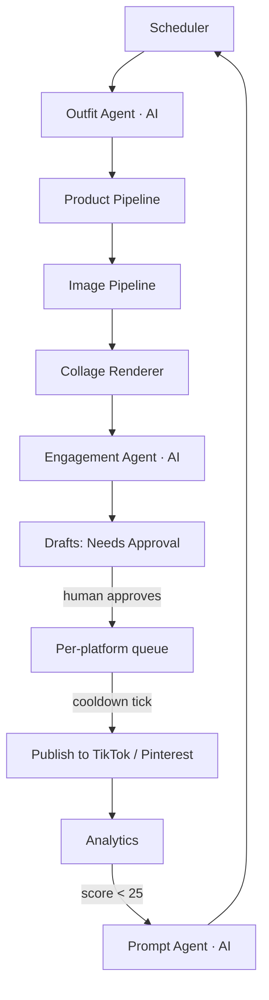

# Pipeline

The end-to-end flow from a creative brief to a published post.

Every stage has a single responsibility. AI is used only where a subjective or
creative decision is required; everything else is deterministic, typed, and
independently testable.

The scheduler and storage layers operate on creative briefs, not generic outfit
labels. A brief may carry a short display phrase, but it always preserves the
contextual fields the Outfit Agent needs to interpret later.

AI stages call the Anthropic Messages API. Each agent requests structured JSON,
and deterministic validators check the response before the pipeline continues —
a malformed response fails the stage instead of leaking into storage.

Volume is meant to feel human-run: 8 active scored concepts, one concept per
run, 5 outfits per concept, 1 TikTok slideshow + 5 Pinterest pins, and no concept
reused within 2 days.

---

## Stages

### Scheduler (deterministic)

1. Load active creative brief concepts, ordered by ranking score.
2. Exclude concepts posted today or on either of the previous two calendar days
   (dates are fixed US-Eastern).
3. Select the top-ranked eligible concept.
4. Pass the full brief forward — never a reduced one-line phrase.

### Outfit Agent (AI)

`app/agents/outfit/` — an opinionated "curator" agent.

1. Read outfit history for the brief to avoid repeats.
2. Get the concept's style facets — ~8 distinct directions (e.g. "Y2K mall
   streetwear", "rockstar leather") generated once and cached on the concept.
   Diversity is structural: each outfit is assigned a different facet, a
   collage template, and a gender presentation (seeded ~70/30 split), rather
   than relying on sampling temperature.
3. Generate one outfit spec per assignment, constrained to its template's item
   composition, with search queries that preserve the brief's important cues.
4. Parse and validate the JSON; malformed output fails the stage.

Output: 5 structured outfit specs, each with a template tag, per-item search
queries, and an interpretation rationale.

After products are found (next stage), the curator **reviews the actual search
results**, approves or rejects each item, and writes refined queries for the
rejects. Only rejected slots are re-searched, for a bounded number of rounds; the
best set found is kept if it never fully approves.

### Product Pipeline (deterministic)

`app/services/product_search_service.py`

1. Reuse an existing product first: an explicit cached pick from the agent, or a
   deterministic near-match on zone + colour family + garment tokens.
2. Otherwise search the configured provider (API-backed, never scraping).
3. Normalize provider fields into internal product candidates.
4. Block resale marketplaces and suspicious retailers; allow cheap retailers only
   for low-stakes categories.
5. Rank candidates and select one product per outfit slot.
6. Store the product with its normal URL and a separate nullable affiliate URL.

### Image Pipeline (deterministic)

`app/pipelines/image_pipeline.py`, `app/services/image_service.py`

1. Download the product image (or pull it from Storage if already processed).
2. Isolate the product: Runflow product-isolation when configured, otherwise
   local `rembg`.
3. Validate the cutout (reject blank/black output) and fall back if it fails.
4. Trim transparent padding and upload the cutout to Supabase Storage.

### Collage Renderer (deterministic)

`app/collage/html_export.py`

1. Lay out the cutouts with the outfit's template (HTML/CSS), styled with the
   batch's shared visual style (background, accent, type) from a small style
   agent, so the five collages read as a set.
2. Screenshot with headless Chromium at 1080×1350.
3. Store the canvas size and per-piece placement (product ID, x/y/width/height)
   so the website can rebuild the collage interactively.

### Engagement Agent (AI)

`app/agents/engagement/`

1. One TikTok slideshow caption + hashtags + music category for the set.
2. Five Pinterest titles/descriptions, one per outfit.

### Publishing (deterministic)

`app/pipelines/publish_pipeline.py`

1. Create 1 TikTok slideshow draft and 5 Pinterest drafts, all unapproved.
2. A human approves drafts in the dashboard; each approval appends to that
   platform's FIFO queue.
3. When autoposting is on, the worker's queue tick publishes the head of each
   platform's queue once its cooldown has elapsed.
4. Store platform IDs and API responses on success; on failure, mark the post
   failed with the API error (retryable from the dashboard).

### Analytics (deterministic)

1. Accept manually entered views, likes, comments, shares, saves, and clicks
   (platform analytics APIs need audited access).
2. Compute an engagement score per post.
3. Convert it into a concept score adjustment, clamped to 0–100.
4. Retire concepts that drop below 25.

### Prompt Agent (AI)

1. When a concept retires, generate a replacement creative brief from engagement
   history.
2. Add it to the `needs_review` pool — new concepts are never auto-activated.

---

## Agent Boundaries

| Agent | Responsible for | Not responsible for |
|---|---|---|
| Outfit | brief interpretation, outfit specs, diversity, search queries | image processing, publishing, analytics |
| Style | one shared background/accent/type style per batch | layout geometry, rendering |
| Engagement | captions, descriptions, hashtags, music category | publishing, analytics |
| Prompt | replacement briefs, concept freshness | scoring, retirement decisions |

No agent calls another agent directly. Every stage takes a typed input, produces
a typed output, and can run on its own. Deterministic stages never erase the
original brief context: a simplified display phrase is derived *in addition to*
the full brief, not instead of it.
